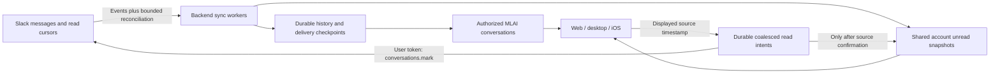

# Slack synchronization: ownership, limits and release acceptance

Slack owns source messages and the user's source read cursor. The backend owns
durable import work, verified coverage, delivery retries and one account-scoped
read-state projection. Web, desktop and iOS render that projection. A local
device's arrival order or optimistic read attempt must not redefine source unread
state.

## Implemented contract

- The selected private history window remains 7 or 30 days (or explicit existing
  all-history consent). Public repair is bounded to the most recent 30 days.
  Both requests and returned rows must satisfy bounds. Older thread roots must
  not prevent in-window replies from known threads being repaired.
- Source event ingestion continues independently of backfill. Durable cursors,
  idempotent source identities, deletion handling and generation fences remain
  authoritative across restarts and concurrent source/history delivery.
- History work rotates workspaces, then owners, then conversations and lanes.
  Shared public channels form one owner group. A large account cannot receive a
  separate owner turn for each of its conversations.
- Four independent history execution slots replace batch barriers: a slow
  page cannot stop a free slot from claiming another conversation. Two slots
  prefer recently opened private rooms across owners until their first
  presentation/publication proof when `MESSAGE_SYNC_OPEN_PRIORITY_ENABLED=true`
  (default). Other unfinished, known-recent private imports and first public
  archives stay within the selected owner's turn. Two slots
  preserve ordinary least-recently-served repair rotation. Current conversation
  leases still exclude simultaneous head/archive/thread writes to one room.
  Owner turns are aggregated once per claim, then the worker selects a room
  within that owner. Large inventories must not repeat a full owner-job scan
  for every candidate room. Future-due jobs retain their owner's service turn.
- Two independent read-state slots use their own bounded thread pool, so
  history executor saturation cannot delay read receipts or unread refreshes.
  Receipt confirmation remains first in each owner's read-state turn. Shared
  provider admission and `Retry-After` apply across all slots and instances.
- Source unread snapshots are collected while clients are closed. Client polls
  read the same owner/consent/OAuth scoped cache; they do not independently fetch
  Slack or add unread counts from their partially received message timelines.
- A read request is persisted before provider I/O. Requests coalesce to the
  highest requested source timestamp. The worker retries after app exit and
  checks the requesting device and consent again. Pending or failed requests
  never masquerade as a Slack-confirmed read.
- A confirmed read publishes one shared snapshot immediately, including
  `confirmed_at`. Partial reads have an unknown remaining numeric count until
  a source refresh establishes it. Older in-flight snapshots cannot undo the
  confirmation. Missing cache entries are not evidence that a channel was read
  or revoked; the explicit authorized target set controls removal.
- Existing owner-private delivery and membership fences remain in force.
  No token, message body or profile is stored in read-intent checkpoints.
- Device recovery prioritizes known, recently active conversations whose old
  room was fenced. Each fair discovery turn can restore one such conversation
  before continuing the historical directory cursor. Recovery rechecks Slack
  access and membership and uses only currently verified devices. It preserves
  the account/source read snapshot across room replacement, but publication
  still waits for the replacement room's bounded history coverage. A failed
  room cannot block recovery of all other recent rooms. Failed recent rooms
  retry after a durable two-minute cooldown, including ambiguous relay
  registration timeouts, through the same membership and registration fences.

## Timing objectives and capacity

The requested initial-import objective is **within two hours**, with useful
recent conversations becoming ready earlier. Explicit opens have a separate
measurement target: first presentation below 20 seconds at p50 and 60 seconds at
p95, and oldest pending opens below 30 seconds at p95. These targets require
production baseline and post-rollout measurements. This is a service objective to
measure, not an unconditional guarantee for arbitrary Slack accounts.

For the verified internal/Marketplace configuration, history and replies each
have a conservative 50-request/minute allowance. Conversation info, directory
listing and read-marker writes also use 50/minute; member and profile reads use
100/minute. Budgets are independent by method but shared by app and workspace
across every account/device. Restricted distribution keeps the one-request/minute
history/reply limit and 15-item pages. Slack Retry-After always takes precedence.

At 50/minute a method can admit at most 3,000 calls/hour or 6,000 calls/two hours
before provider latency, cooldowns and other account work. History pages contain
up to 200 messages in the internal configuration, but many conversations/threads
need separate requests even with few messages. An account with 1,256 unknown
conversations needs at least 25.1 minutes for one info call each in isolation;
6,433 such calls need at least 128.7 minutes. More local workers cannot bypass
this workspace quota.

For a measured import, estimate the lower bound as the maximum of each method's
required calls divided by its admitted calls/minute; do not add independent
method quotas together as if they were serial. Add measured queue competition,
provider backoff and relay delivery time. Do not show a completion percentage or
ETA while conversation discovery or thread pagination is still unbounded/unknown.

### Measuring capacity before adding instances

Run `python manage.py message_sync_status --window-minutes 5` in the deployed
worker. `provider_throughput` reports completed minute buckets per opaque
app/workspace/method scope: admitted requests, local admission deferrals, actual
provider 429s, failed requests, mean request latency and use of our configured
budget. Minute counters expire after 20 minutes; completed hourly buckets are
available with `--window-hours 24` and retained for seven days. Counters are
queued without blocking messages and may be dropped if the bounded telemetry
queue or cache is unavailable. Partial windows report unknown utilization,
and even observed buckets are best-effort lower bounds. They contain no source IDs, tokens or
message content, and cannot affect synchronization if telemetry fails. An absent
scope means no recorded samples, not proof of zero demand. Allow a complete
measurement window after rollout; compare equivalent backlog and owner load.

`due_jobs` includes only currently eligible conversations and reports oldest due
times. Use it with provider throughput and delivery backlog: low admission with
old eligible work suggests local scheduling/processing constraints; sustained
budget use or provider cooldowns suggests a Slack quota constraint. Empty queues
with low utilization are normal. One app/workspace cannot multiply its quota by
adding worker instances or IP addresses. Avoid a completion-time claim based only
on requests/minute: record verified window coverage and publication completion.

The headless and Discord entrypoints use the same execution pools. Each slot
submits at most one call, uses a bounded polling delay, and closes obsolete DB
connections between calls. Shutdown stops new claims; existing lease and consent
fences still protect any synchronous request finishing after cancellation.

MLAI-origin read confirmation is attempted immediately and retried durably when
limited. Other foreground MLAI clients converge through their next shared-cache
poll (normally ten seconds after confirmation, plus network time). Slack itself
receives the confirmed marker through `conversations.mark`. Reads performed
inside Slack are discovered by background polling; freshness depends on the
number of conversations/accounts sharing the workspace quota. The normal Events
API does not provide user `im_marked`/`channel_marked` callbacks, so this design
does not claim bidirectional instantaneous read-marker push.

## Acceptance before declaring the objectives achieved in production

1. Deploy matching backend and clients; verify all five worker lanes and the
   exact installed mobile build. A healthy heartbeat alone is not proof of data
   completeness.
2. With all clients closed, import synthetic accounts with 30-day history,
   older conversations, recent replies to old known roots, edited/deleted posts,
   and uneven account sizes. Record discovery completion, initial source
   coverage, publication completion and source unread coverage separately.
3. Demonstrate two-hour completion for an explicitly recorded volume/concurrency
   envelope. Include request counts by method, provider cooldown time and
   end-to-end elapsed time. Repeat with a competing large account and verify
   small-account progress. Synthetic tests verify scheduling, not production
   throughput.
4. Read a synthetic message on iOS. Verify Slack's cursor, web and desktop
   converge without receiving different message subsets. Repeat on each client,
   under a 429, app termination and a worker restart. An older concurrent read
   must not move the source cursor backwards; a partial read must preserve the
   unread remainder.
5. Read/mark unread inside Slack and measure the next backend observation and
   client convergence. Report actual p50/p95/worst lag rather than presenting
   polling as real time. Verify revoked consent/devices cannot replay queued
   writes or retrieve cached state.

## Boundaries that must remain explicit

- Slack exposes IM unread counts directly; other conversation types require
  bounded source-history calculation. Truncated/consent-limited counts are
  unknown, never fabricated. Slack-specific notification preferences, subteam
  mentions, thread badges and Catch Up totals cannot be equated to DM counts.
- Old unread messages outside the selected import window may contribute to
  Slack's IM count even though their bodies are not imported. Do not mark them
  read merely to make the two apps' visible-window counts agree.
- Discovering previously unknown old thread roots with recent replies cannot be
  proven complete using only a bounded top-level history scan. Known roots and
  live callbacks are repaired; broader search/import support needs a separate
  consented source capability and coverage contract.
- Existing private-room identity includes its verified audience. Adding a new
  device can change that identity and require history replay. Safely eliminating
  that replay requires coordinated relay support for stable owner-conversation
  identity and membership generations, or a reviewed encrypted canonical cache.
  Skipping the current reset would break audience/privacy guarantees.
- Current source support excludes Slack Connect conversations, pending external
  shares, and shared conversations whose audience Slack has not classified.
  Enterprise channels explicitly shared only within the organisation remain
  eligible under the same owner consent and device access checks. Source retention,
  missing permissions and unavailable history must be reported as limited scope.

Sources: [Slack rate limits](https://docs.slack.dev/apis/web-api/rate-limits/),
[history](https://docs.slack.dev/reference/methods/conversations.history/),
[read markers](https://docs.slack.dev/reference/methods/conversations.mark/),
[IM marker events](https://docs.slack.dev/reference/events/im_marked/),
[members](https://docs.slack.dev/reference/methods/conversations.members/),
[profiles](https://docs.slack.dev/reference/methods/users.info/).

## Responsiveness changes prepared on 13 October 2026

Pending explicit opens carry an opaque timestamp preference and receive at most
three of four discovery turns. FIFO within an owner, durable provider delays,
consent and lease checks remain in force. The first archive page and private
message delivery receive open priority until the room has an acknowledged
presentation; ordinary history slots and thread repair retain fairness.
Scheduled possibly-unread read re-probes use background admission. Fresh source
activity, pending hints, explicit marks and receipts retain foreground priority.
Read-state observation age must be measured after rollout against the approved
p95 objective under five minutes; source-code tests do not prove this objective.

`message_sync_status` now includes open latency aggregates, live open queue ages
and discovery liveness/backlog/error counts. Both discovery loops heartbeat at
most every five seconds, without counting shared-budget pacing as failure.
`--check` remains unchanged pending deployed discovery heartbeat evidence.

Unread prefetch is implemented behind `MESSAGE_SYNC_UNREAD_PREFETCH_ENABLED`
(default `false`) and the per-owner hourly cap
`MESSAGE_SYNC_UNREAD_PREFETCH_PER_HOUR` (default `6`). Opens and device recovery
run first. Prefetch rechecks source consent/membership/window and includes every
verified device; the import proceeds at normal background priority. Activation
still requires the B2/B3 measurements and the human operations rollout. See the
[implementation record](chat-responsiveness-implementation-2026-10-13.md) for
source validation and outstanding production checks.

### Targeted routing of parked private events (prepared 20 October 2026)

Group-DM and private-channel callbacks are parked as owner-scoped ciphertext
until discovery re-reads membership, even when the room is already live. With
`MESSAGE_SYNC_TARGETED_STAGED_ROUTING=true` (default `false`; requires
`MESSAGE_SYNC_ENABLED=true`), each owner's discovery turn handles up to three
parked channels after explicit opens and before device fan-out, recovery,
prefetch and the directory page. Each channel gets one fresh
`conversations.info` and the existing paged `conversations.members` read under
the same grant authority, shared budgets and discovery lease, then the
unchanged `_discover_conversation` and staged-event drain. A brand-new group DM
or private channel with a message therefore becomes the owner's room without a
tap; consent, private-channel consent, Slack Connect exclusion, the history
window and the all-device audience are unchanged.

A type the grant cannot read is never probed, because Slack's `missing_scope`
revokes the grant; such events are discarded as the sweep's type filter would.
Archived (outside all-history consent) and Slack Connect sources are retired
exactly as a directory listing would. Unavailable or non-member sources are
discarded without delivery. Untyped events on partially scoped grants,
sources without positive membership, closed new sources and rooms that are not
live after provisioning stay parked with a bounded retry time, and the sweep
remains the fallback. The checkpoint
`slack_targeted_staged_routing_v1` holds only channel IDs, due times and attempt
counts.

Every staged drain now logs `slack_staged_routed grant_id=… path=… events=…
latency_ms=…` (oldest parked event to delivery-queue insert) and records the
`staged_routed` aggregate in `message_sync_status`. This also measures the
sweep path while the flag is off. A membership fingerprint that skips the
re-check for live rooms is not implemented: without membership-change event
subscriptions there is no signal that could invalidate it safely.
